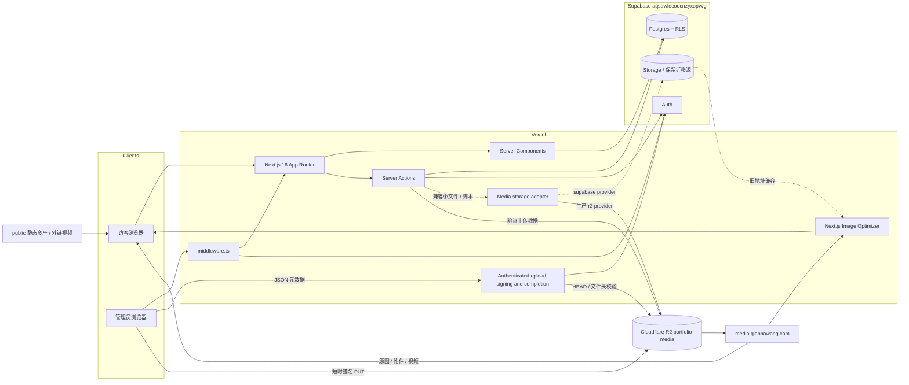

# 系统架构（qianna-website）

> **稳定架构说明**——技术栈、分层、数据流、横切能力。  
> 进度、本地环境、文件索引见 [`developer-guide.md`](developer-guide.md)；Agent 入口见 [`AGENTS.md`](../AGENTS.md)。

最后更新：2026-10-10

---

## 1. 系统上下文

个人作品集站点：**Next.js App Router** 渲染前台与 Admin CMS，**Supabase** 提供 Postgres、Auth，**Cloudflare R2** 存储生产公开媒体。2026-10-10 已完成 160 文件复制和 159 行引用切换，生产上传使用 `MEDIA_STORAGE_PROVIDER=r2`。接口在未指定 provider 时默认 Supabase；原桶保留用于回滚。



| 项 | 值 |
|---|---|
| 生产 URL | https://www.qiannawang.com |
| 托管 | Vercel（`main` 自动部署） |
| 数据库 / Auth | Supabase Project `aqsdwfocoocnzyxopvvg` |
| 生产媒体 | Cloudflare R2 `portfolio-media`，公开交付域名 `media.qiannawang.com` |
| 上传接口 | `lib/media/storage.ts`；provider 未指定时默认 `supabase`，生产显式为 `r2` |
| 保留迁移源 | Supabase Storage `portfolio-media`；原 URL 可读，源对象未删除 |

---

## 2. 技术栈

| 层 | 选型 |
|---|---|
| 框架 | Next.js **16.2.1**（App Router） |
| UI | React **19** + TypeScript |
| 样式 | Tailwind CSS **v4**（`app/globals.css`） |
| 后端即服务 | Supabase（`@supabase/ssr` + `@supabase/supabase-js`） |
| 富文本引擎 | **Tiptap v3**（`@tiptap/react` + `@tiptap/markdown` + 表格/图片扩展） |
| 图片处理 | `sharp`（迁移 / Admin 上传压缩） |
| 对象存储客户端 | `@aws-sdk/client-s3` **3.1148.0**，R2 S3-compatible API |
| 前台图片 | `next/image`（Hero 等，`fill` + `priority`） |
| 分析 | 自研 `page_views` 表 + Vercel Analytics / Speed Insights |
| 反垃圾 | Cloudflare Turnstile（Guestbook） |

---

## 3. 仓库分层

```
app/
  page.tsx, layout.tsx          # 前台布局、首页、全局 metadata
  <route>/page.tsx              # 各内容页（Server Component）
  _components/                  # 前台共享组件（Hero、Reveal、Guestbook…）
  _data/*.ts                    # 静态回退数据（无 Supabase 时 build 仍可通过）
  admin/**                      # CMS：表单、MediaManager、Server Actions
  auth/callback|confirm         # Supabase Auth 回调
  analytics/actions.ts          # 页面浏览上报
  sitemap.ts, robots.ts         # SEO

lib/
  <module>/queries.ts           # 读库 + isSupabaseConfigured() 回退
  supabase/                     # server / client / public-env
  seo/                          # metadata、canonical、sitemap 数据
  media/                        # Hero 压缩 + storage.ts / storage-core.ts 存储接口
  admin/, analytics/, guestbook/, notes/, projects/ …

supabase/migrations/            # 0001–0019 SQL（建表、RLS、GRANT；0019 生产已部署；管理员授权已完成）

scripts/                        # 初始化脚本、下载脚本、migrate-storage-to-r2.mjs
tests/                          # 存储接口与迁移流程测试

middleware.ts                   # /admin 鉴权；首页 Auth 参数转发
```

**原则：** 页面薄、查询厚；Admin 写操作集中在 `"use server"` 的 actions 文件。

---

## 4. 请求与渲染

### 4.1 前台页面

1. **Server Component** 调用 `lib/*/queries.ts`
2. 各查询模块按自身规则使用 `app/_data/*` 回退；未配置、查询失败等处理以对应 `queries.ts` 为准，空结果不统一视为故障
3. 需要交互的区块用 Client Component（如 `GuestbookSection`、`HeroImageDistortionClient`）

### 4.2 Admin

1. `middleware.ts` 校验 Supabase session；未登录 → `/admin/login`；已登录透传 `x-user-id` / `x-user-email` 请求头
2. 页面端通过 `getAdminAuthSession()` 读取 middleware 注入的已验证请求头，减少重复的远程 Auth 调用；请求头缺失时回退到 `auth.getUser()`
3. 全局 `app/admin/loading.tsx` 骨架屏配合路由预取，提供加载过渡；布局使用 `AdminShell` 和 `AdminSidebar`
4. 页面读操作与关联资源采用 `Promise.all` 并发查询；富文本等重型组件使用 `next/dynamic`（`ssr: false`）按需加载
5. 只有 `isSupabaseConfigured()` 为 false 时 middleware 放行；`public-env.ts` 内置本站公开连接回退，省略环境变量并不等于离线
6. 表单提交 → **Server Actions** → Postgres / 媒体存储接口 → `revalidatePath`；上传前通过 `auth.getUser()` 校验会话

### 4.3 Next.js 16 注意点

- 动态路由 `params` / `searchParams` 可能是 **Promise** → 需 `await`
- `"use server"` 文件 **不可 re-export** 其他 server action
- `useSearchParams` 需外层 **Suspense**

（详见 [`AGENTS.md`](../AGENTS.md)）

---

## 5. 数据架构

### 5.1 Postgres 模块（迁移 0001–0019）

| 迁移 | 领域 |
|------|------|
| 0001–0004 | projects, photography, visual_works, field_notes |
| 0005–0006 | site_settings, site_navigation_items |
| 0007, 0016 | about_page_content, profile_image |
| 0008–0009 | projects preview copy |
| 0010–0011 | notes, notes i18n |
| 0012 | traces navigation |
| 0013–0014 | guestbook, email |
| 0015 | page_views (analytics) |
| 0017 | undergraduate portfolio |
| 0018 | hide xicaoshi project |
| 0019 | workbench_pipelines（生产已部署，2 条流程；写入仅 CMS admin，异常时静态回退） |

每张业务表：**RLS** + 对 `anon` / `authenticated` 的 **GRANT**（公开读、Admin 写）。

### 5.2 静态回退

```text
Supabase 查询成功 → 按模块映射数据库结果
未配置 / 查询故障等 → 按模块使用 app/_data/*.ts 的版本化默认数据
```

静态回退用于保持页面可用，并非生产数据库实时镜像。`public-env.ts` 使用环境变量或内置公开连接；若需要验证真正未配置分支，应显式将 Supabase URL 和 key 都置空，不能只删除 `.env.local`。

摄影前台先读取已发布集合，再批量读取照片并按集合分组；按接口返回数量分页，保留空集合 / 查询失败的静态回退。当前 46 张图需要 2 次 REST 查询，不新增跨请求共享缓存。

### 5.3 Storage

- 统一接口：`lib/media/storage.ts`（server-only）→ `storage-core.ts`；`MEDIA_STORAGE_PROVIDER` 默认 `supabase`，可显式切为 `r2`。
- 2026-10-10 生产已显式配置 `r2`：160 对象复制并校验，159 行媒体引用切换；Supabase 原对象保留，数据库与 Auth 不变。见 [执行记录](exec-mcp-storage-2026-10-10.md)。
- Supabase Bucket：`portfolio-media`。R2 桶由 `R2_BUCKET_NAME` 配置，公开 URL 使用 `R2_PUBLIC_BASE_URL` 自定义域名；S3 凭据仅保存在服务端。
- 路径采用模块目录；新版后台使用 `uploads/<scope>/<user-id>/<uuid>.<ext>`；Hero 完成压缩后生成新的 WebP 键。既有 `site/home-hero-<uuid>.webp` 和旧 `site/home-hero.webp` 引用继续有效。
- 存量迁移对象键为 `legacy/portfolio-media/<旧对象键>`；新版后台直传使用 `uploads/` 的用户与 scope 目录。`R2_PUBLIC_BASE_URL` 是交付域名，S3 endpoint 用于受签名保护的读写，短时 PUT URL 可下发到管理浏览器；私钥仅在服务端，业务表保存公开 URL。
- 新版上传：`/api/admin/media` 验证 Auth 与服务端 CMS admin 标记，签名 10 分钟 PUT；浏览器直接传 R2。完成阶段 HEAD 与文件头验证，Hero 再用 `sharp` 压缩（1920px WebP q75）。Server Action 核验绑定用户 / scope 的 HMAC 收据与对象，再写入 DB；R2 配置失败不回退。代码尚待部署，实际状态见剩余迁移记录。
- 迁移脚本：`npm run migrate:r2`，明确分清点、计划、复制、公开校验、更新引用与回滚阶段，复制存量到 `legacy/portfolio-media/`，不删除源对象。
- `next.config.ts` 同时允许 Supabase 与配置的 R2 域名；R2 规则限定 HTTPS、主机、路径且拒绝查询参数。生产继续使用 next/image 优化；代理 DNS 的本地预览可设 `DEV_IMAGE_UNOPTIMIZED=true`，仅 development 生效，未开启私网源访问。
- 新对象默认 `Cache-Control: public, max-age=31536000, immutable`，不可覆盖写入使用 `If-None-Match: *`；可覆盖的初始化上传缓存为 1 小时。替换图片生成新 URL。删除业务记录不会自动清理对象，需要另行核对引用。
- Field Notes 的 Google Drive 大视频只存外链，迁移时保留。新版浏览器签名直传已实现，图片 / 附件 32 MiB、MP4 256 MiB；现有外链保持。代码上线前的旧上传仍受 Vercel 请求体限制。
- 执行方案、实测清点与回滚见 [`exec-cloudflare-r2-2026-10-09.md`](exec-cloudflare-r2-2026-10-09.md)。
- 日常配置、裂图排查、部署验收与回滚步骤见 [`experience-media-storage.md`](experience-media-storage.md)。

---

### 静态媒体交付

- `public-media-manifest.json` 记录文件路径、内容哈希与 R2 键；`resolvePublicMedia()` 只解析清单中的文件，页面路径与外链不受影响。
- `migrate:static-media` 默认只读计划，`--apply` 上传并逐文件验证；全量校验成功后才发布清单。本轮 182 内容资产 / 574.01 MiB，6 个 SVG UI 文件保留本地。
- `STATIC_MEDIA_PROVIDER` 默认跟随上传 provider；可设 `local` 并重新构建以独立回退静态交付。Next 只将公开域名注入前端，原文件与原桶迁移清单保留。
- 分项状态与发布门槛见 [剩余迁移执行记录](exec-cms-storage-completion-2026-10-10.md)。

### 图片展示性能

- `lib/media/image-sizes.ts` 与既有容器宽度、卡片间距和网格断点对应，供首页及图集选择响应式规格；改布局时同步更新。
- `lib/media/image-config.ts` 共用公开来源规则，供 Next.js 优化器和 Notes 判断使用，远程白名单保持原有约束。
- Notes 用 `NoteImage` + `getImageProps` 提供响应式 URL、lazy / async；已知本地图从构建前生成的尺寸清单预留真实比例，未知比例和外部来源用原生 img 保持兼容，优化失败可回退原图。
- 构建自动刷新 `lib/notes/local-image-metadata.json`；不修改上传管线和原始对象。当前实现及部署状态见 [性能第一阶段执行记录](exec-image-performance-p1-2026-10-10.md)。

## 6. CMS 模块模式（新功能模板）

每个内容模块统一四层：

```text
supabase/migrations/000X_*.sql     → 建表 + RLS + GRANT
app/_data/*.ts                     → 静态回退
lib/<module>/queries.ts            → 查库 + fallback
app/<module>/page.tsx              → Server Component
app/admin/<module>/**              → CRUD + MediaManager + Server Actions
scripts/migrate-<module>.mjs       → sharp → Storage → DB
scripts/download-*-media.ps1       → sparse-checkout 下补 public 文件
```

**Admin 约定：** 变更后 `revalidatePath`；封面走 Storage 公开 URL。

完成度 checklist：[`cms-migration-checklist.md`](cms-migration-checklist.md)

---

## 7. 横切能力

### 7.1 认证

- Supabase Auth（邮箱 + 密码）
- `middleware.ts` 保护 `/admin/*`
- `/auth/callback`、`/auth/confirm` 处理 magic link / 重置密码
- 生产 **Site URL** / **Redirect URLs** 须含 `https://www.qiannawang.com`（见 [`exec-vercel-domain-2026-08-11.md`](exec-vercel-domain-2026-08-11.md)）

### 7.2 SEO

- `lib/seo/constants.ts`：`getSiteUrl()` 生产固定 canonical 域名
- `lib/seo/metadata.ts`：页面 title / description / OG
- `app/_components/seo/JsonLd.tsx`：Person + WebSite 结构化数据
- `app/sitemap.ts`：动态 sitemap（DB + 静态路由）
- 经验：[`experience-seo-metadata.md`](experience-seo-metadata.md)

### 7.3 Analytics

- 前台：`PageViewTracker`（Client）→ Server Action → `page_views`
- 后台：`/admin/analytics` 聚合展示
- 路径规范化：`lib/analytics/paths.ts`

### 7.4 Guestbook

- 前台预览（首页 3 条）+ `/guestbook` 全量
- Turnstile 校验 → Server Action → `guestbook_messages`
- 后台审核 / 隐藏：[`experience-guestbook.md`](experience-guestbook.md)

### 7.5 首页 Hero 与动效

| 能力 | 实现 |
|------|------|
| Hero 图源 | CMS `site_settings.hero_image_url` → R2；新版直传使用 `uploads/site-hero/<user-id>/<uuid>.webp` |
| 加载性能 | `next/image` + Admin/`recompress:home` 压缩 (~400KB) |
| Ken Burns / 文字 stagger | `globals.css` + `page.tsx` |
| 区块滚入 | `Reveal.tsx`（IntersectionObserver，`prefers-reduced-motion`） |
| WebGL 涟漪 | `HERO_DISTORTION_ENABLED = false`（可配置关闭） |

详见 [`experience-homepage-motion.md`](experience-homepage-motion.md)、[`exec-homepage-motion-2026-08-17.md`](exec-homepage-motion-2026-08-17.md)

### 7.6 Projects 详情

- Layout 变体：thesis | xicaoshi | portfolio（flipbook）
- Portfolio：`PortfolioFlipBook` + `lib/projects/portfolio-flip-pages.ts`

### 7.7 Workbench

- 首页 `WorkbenchSection` 与 `/workbench` 读取 `lib/workbench/queries.ts`；缺表、查询失败或空数据时使用 `app/_data/workbench.ts`。
- `/admin/workbench` 与 `/admin/workbench/[id]` 已有编辑和初始化功能；生产 `0019_workbench_pipelines.sql` 已部署；2 条流程公开读取已验证，写入要求服务端 `app_metadata.cms_role=admin`。现有唯一 CMS 账号已授权；2026-10-12 本地新版认证直传与保存、生产数据库 RLS 验收通过，新代码仍待部署。详见 [授权验收](exec-cms-admin-verification-2026-10-12.md)。

---

## 8. 部署与环境

### 8.1 Vercel

- 连接 GitHub `24205345/qianna-website`，`main` 分支部署
- 环境变量（Production）至少：

```text
NEXT_PUBLIC_SUPABASE_URL
NEXT_PUBLIC_SUPABASE_ANON_KEY
NEXT_PUBLIC_SITE_URL=https://www.qiannawang.com
MEDIA_STORAGE_PROVIDER=r2
R2_ACCOUNT_ID
R2_BUCKET_NAME=portfolio-media
R2_PUBLIC_BASE_URL=https://media.qiannawang.com
R2_ACCESS_KEY_ID
R2_SECRET_ACCESS_KEY
```

R2 Access Key / Secret 仅服务端读取，在 Vercel 使用 Sensitive 保存。Preview 环境需单独配置；生产变量不会自动保证 Preview 可用。修改 provider 或图片源配置后重新部署。MCP OAuth 用于平台管理，不替代应用的 S3 凭据。

Guestbook Turnstile 见对应经验文档。迁移管理员邮箱/密码不放入 Vercel；`.vercelignore` 排除 `.env*`、清单和本机配置。正式执行的部署与验证结果见 [迁移记录](exec-mcp-storage-2026-10-10.md)。

### 8.2 本地

- `.env.local` 从 `.env.local.example` 复制（勿提交）
- 迁移脚本用 `SUPABASE_ADMIN_EMAIL` / `SUPABASE_ADMIN_PASSWORD`（**非** service_role）
- `DEV_IMAGE_UNOPTIMIZED` 只用于本地代理 DNS 导致的图片优化故障，恢复公共 DNS 后关闭并重启开发服务

### 8.3 sparse-checkout

普通 clone 包含已跟踪的 `public/` 资产；仅在使用 sparse-checkout 或文件确实缺失时考虑下载脚本。当前生产迁移保留本地静态路径及外链，不能因为引入 R2 就删除这些资产。见 [`developer-guide.md`](developer-guide.md) §4。

---

## 9. 相关文档

| 文档 | 用途 |
|------|------|
| [`developer-guide.md`](developer-guide.md) | 进度、路由速查、本地开发、坑表 |
| [`README.md`](README.md) | 文档索引 |
| [`cms-migration-checklist.md`](cms-migration-checklist.md) | 模块验证清单 |
| [`exec-*.md`](.) | 单次交付记录 |
| [`experience-*.md`](.) | 可复用模式 |

### 首页展示图覆盖（2026-10-12 数据库已执行，代码待发布）

SiteSettingsForm 常驻文件输入 → site-featured 签名直传 → updateSiteSettingsAction 校验管理员、实际首页目标及回执 → home_featured_images 按稳定 item_key 写入。首页和后台预览应用覆盖 URL；null 恢复项目库/静态来源的原图。该覆盖层与原图库、项目详情分离，仅读取公开展示图片 URL；RLS 仅非匿名 CMS admin 可写。两项生产迁移已执行并验证 RLS；JWT 查询以独立 SELECT 计算，避免逐行重复求值。本地浏览器真实保存、刷新与恢复已通过，代码尚待部署。迁移与上线状态见 [执行记录](exec-site-featured-images-2026-10-12.md)。
