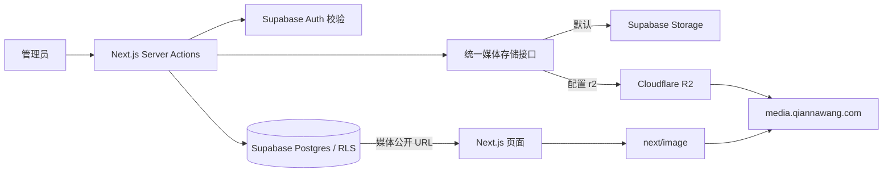

# Cloudflare R2 媒体存储改造与执行步骤

更新时间：2026-10-10（Asia/Shanghai）。代码基线：GitHub `main` / `decd6ac`。最新接入和执行状态见 [MCP 接入记录](exec-mcp-storage-2026-10-10.md)。

## 1. 决策与项目理解

这是 Next.js 16.2.1 / React 19 的个人作品集，Vercel 运行前台和私有 Admin CMS。页面通过 `lib/*/queries.ts` 读取 Supabase，失败时使用 `app/_data/*` 静态回退。数据库维护 Projects、Photography、Visual Works、Field Notes、首页、About、Notes、Guestbook、Analytics 和 Workbench；Admin 写操作集中在 Server Actions。Supabase Auth 验证管理员，Postgres RLS 管理内容读写，Turnstile 保护留言。

媒体迁移建议：**保留 Supabase Postgres / Auth，将公开媒体对象移到 Cloudflare R2，业务表继续保存媒体公开 URL。** 这样无需同时改造数据库、登录和前台呈现，可以逐步验收。R2 负责文件存储；图片尺寸优化继续由现有 sharp / next/image 完成。

本次读取了 AGENTS、开发指南、架构、CMS 清单、SQL 迁移、查询层和全部后台上传入口。没有 `.codegraph/` 索引，使用文件检索定位。仓库已有 Supabase 媒体迁移记录，但未找到独立的 R2 方案。



2026-10-10 已启用 R2 并创建 `portfolio-media` Standard 桶，绑定 `media.qiannawang.com`；域名归属与 SSL 均为 active。160 文件已复制并通过公开 SHA-256 验证，159 行引用已切换，生产上传 provider 为 `r2`。执行证据和回滚清单见 [接入记录](exec-mcp-storage-2026-10-10.md)。

## 2. 线上只读清点结果

迁移前使用现有管理员配置只读清点，所得对象数和总大小在迁移后再次核对一致，原文件均保留。

| 项目 | 数量 |
|---|---:|
| `portfolio-media` 对象 | 160 |
| 对象元数据合计大小 | 101.36 MiB |
| 被已扫描 CMS 字段引用的不同对象 | 159 |
| 需要改写的数据库行 | 159 |
| Projects | 3 |
| project_media | 20 |
| Photography photos | 46 |
| Visual Works | 22 |
| Field Notes | 5 |
| Field Note media | 66（62 张图的 URL 需迁移，4 个外链视频保持原地址） |
| Notes | 3（本次没有命中 Supabase 附件链接，工具仍支持中英正文） |

大小来自 Storage 列表的元数据，正式复制会读取对象并记录实际字节数与 SHA-256。所谓“未被引用”仅针对扫描字段，不意味着可以删除。

发现的部署差异：`workbench_pipelines` 返回 `PGRST205`，数据库未部署 `0019_workbench_pipelines.sql` 对应表。当前 Workbench 前台走静态回退；后台 CMS 保存需要补齐该迁移。工具仅对这个明确可选且缺失的表记录跳过，其他读表/权限错误会中止。

本地评估清单：`.media-migration/r2-assessment.json`，使用建议域名生成，**不是正式切换清单**。没有填入 R2 Account ID，配置真实目标后必须重新生成默认 `r2-plan.json`。

## 3. 本次代码交付

- `lib/media/storage-core.ts`：Supabase / R2 共用上传接口。默认 Supabase；显式选择 R2 后，配置错误或上传失败会直接报错。R2 使用官方 S3 SDK、`region: auto`，密钥仅服务端读取，新增对象使用 `If-None-Match: *` 防止覆盖。
- `lib/media/storage.ts`：Server-only 入口。后台仍在调用上传前使用 `auth.getUser()` 校验会话。
- 后台所有 9 个上传 actions 文件、6 个既有媒体脚本均接入同一个接口。保留 Hero sharp 压缩。Hero 每次生成新对象 URL，避免旧缓存；其他新增媒体沿用原有唯一路径。
- `next.config.ts`：允许配置的 R2 媒体域名/路径，保留 Supabase 域名以支持混合迁移。R2 规则拒绝查询参数，没有开放任意远程域名。
- `scripts/migrate-storage-to-r2.mjs`：只读清点、生成清单、复制、校验、更新引用、回滚。既有初始化脚本可能清空和重建数据，不应拿来迁移线上存量。
- `.env.local.example`：新增配置占位；`.gitignore`：忽略本地清单及原始 CMS 值。

存量对象复制到 `legacy/portfolio-media/<原路径>`。保留目录与原文件字节；新上传继续采用各模块已有目录。数据库无需新增列或修改 RLS。

## 4. Cloudflare 和 Vercel 配置

1. 创建 R2 Standard 桶，例如 `portfolio-media`。该桶只放网站公开媒体。
2. 将媒体子域名加入桶的 Custom Domains，并等待 Active。域名须属于同一 Cloudflare 账户中的 zone；非 Cloudflare DNS 域名应按官方支持的 zone 接入流程配置，不能直接 CNAME 到 `r2.dev`。
3. 创建仅限该桶的 Object Read & Write API 凭据，保存 Access Key ID / Secret Access Key。应用不需要账户全局密钥。
4. 在本地 `.env.local` 和 Vercel 配置以下变量。Secret 不要带 `NEXT_PUBLIC_` 前缀，也不要发到聊天或提交 Git。

```dotenv
MEDIA_STORAGE_PROVIDER=supabase
R2_ACCOUNT_ID=<Cloudflare Account ID>
R2_ACCESS_KEY_ID=<Access Key ID>
R2_SECRET_ACCESS_KEY=<Secret Access Key>
R2_BUCKET_NAME=portfolio-media
R2_PUBLIC_BASE_URL=https://media.qiannawang.com
```

首次部署仍保持 `MEDIA_STORAGE_PROVIDER=supabase`，让旧图片和已迁移图片都能通过 next/image 加载。切换后才改为 `r2`。R2_PUBLIC_BASE_URL 是公开地址配置，私钥不会发给浏览器。

自定义域名支持 Cloudflare 缓存；`r2.dev` 是有限速的开发入口，不作为生产地址。新对象使用长缓存与唯一 URL；旧初始化脚本的可覆盖路径使用 1 小时缓存。若以后改变缓存规则，保留这一区分。当前上传从服务器到 R2，不需要浏览器 PUT CORS；以后签名直传再配置明确的允许来源与请求头。

## 5. 正式迁移顺序

需要 Node 24（项目已有 v24.16.0），脚本用 Node 原生 TypeScript stripping 与 `parseEnv`。保留当前 Supabase 管理员登录方式，不使用 service_role。以下每步成功后再执行下一步；清点、计划失败时先修复，不要继续。

```powershell
$env:Path = "G:\project\.runtimes\node-v24.16.0-win-x64;" + $env:Path
npm run migrate:r2 -- --inventory
npm run migrate:r2 -- --plan
npm run migrate:r2 -- --copy
npm run migrate:r2 -- --verify
npm run migrate:r2 -- --apply
```

操作顺序：

1. 配好桶、公开域名和凭据，部署支持双域名的本次代码。
2. 暂停 CMS 编辑和其他媒体迁移脚本，生成正式计划。备份默认 `.media-migration/r2-plan.json`，检查对象数、目标域名、改写表和跳过表。已有清单不能被 `--plan` 覆盖；需要新计划时用另一个 `--manifest` 路径。
3. `--copy` 分页递归复制整个桶，包括未被当前扫描字段引用的对象，最多四路并发控制传输和内存。源下载后计算 SHA-256；R2 上传后再通过 S3 GET 核对字节。遇到目标冲突或源对象已变化会停止新任务，等待在途任务完成检查点，绝不覆盖或删除。清单逐文件落盘，失败后可重跑复制。
4. `--verify` 从公开域名下载并校验 SHA-256。`--apply` 也强制重复这一步，全部通过才改写数据库引用。
5. `--apply` 更新封面、画廊、视频文件 URL、Notes 中英 Markdown、相关 JSON。仅处理指定项目桶地址；Google Drive 外链和本地静态路径保留。缺失对象、无法识别的 URL 或带不支持参数的旧链接会阻止计划生成。
6. 更新引用采用比较原值和原子并发校验；有 `updated_at` 的表使用现有触发器版本，避免把长篇 Markdown 放进请求 URL。用户在计划后改动相关字段时会停止，不会覆盖该内容。清单在数据库写入前后均记录状态，支持中断恢复。
7. 检查首页、Projects 详情/视频、Photography、Drawings、Field Notes、About、Notes 图片/附件和后台预览；确认 next/image、PDF、Range 请求（如有视频）及缓存正常。
8. 将 Vercel `MEDIA_STORAGE_PROVIDER` 切为 `r2` 并重新部署。逐模块测试真实后台上传后恢复 CMS 编辑。CLI 更新不触发应用内 `revalidatePath`，用重新部署/缓存失效完成切换验收。
9. 保留 Supabase 原对象和本地清单作为回滚来源。删除旧文件、清理 Git 中的大图、删除 R2 孤立对象均不包含在本次脚本中，后续应单独核对引用和备份。

失败后重跑对应阶段。默认清单路径不变；若指定其他 `--manifest`，后续每个命令都必须指定同一路径。

```powershell
npm run migrate:r2 -- --rollback
```

回滚按清单恢复原数据库字段，保留两端对象。若切换后又编辑了相关字段，回滚会停止并提示人工核对。上传 provider 需另外改回 `supabase` 并重新部署；provider 开关本身不会恢复已经迁移的 URL。

## 6. 下一阶段优先级

1. **持续验收部署与保留回滚来源。** 后续 GitHub 部署使用本次改造代码及已有 Vercel R2 配置；保留 Supabase 源对象和本地回滚清单。代理 DNS 环境下的本地图片直读开关仅在开发环境生效。
2. **签名直传处理大文件。** 目前后台仍将文件传到 Server Actions；Vercel Functions 请求/响应体限制是 4.5 MB，`bodySizeLimit: 20mb` 无法改变托管平台限制。大图/视频下一步用经过 Auth 校验的短时签名 PUT，再在服务端校验对象大小、类型和存在性后写 DB；保留 Hero 压缩流程。
3. **补齐 Workbench 数据表。** 仓库 `0019` 已有 SQL，但线上表缺失；这是独立的 CMS 部署缺口。
4. **资产元数据与清理机制。** 确有跨模块管理需要时，增加 provider、bucket、object_key、content_type、bytes、checksum 等资产信息及引用关系，再做孤立对象清理。第一步不必同时重写全部业务表。
5. **依赖安全维护。** 当前 npm audit 报告 16 项（含 Next、sharp 等既有依赖）；新增 `@aws-sdk/client-s3` 不在审计问题名单中。另开依赖更新工作，升级后完整回归；此次没有运行强制修复。

## 7. 验证与限制

- 存储/迁移 20 项测试通过：默认兼容、R2 条件写入、URL 编码、配置错误、分页目录、中英 Markdown/JSON、外链保留、并发编辑保护、恢复和回滚，以及并发上限和失败时等待在途检查点。
- `npm run lint`、`npx tsc --noEmit`、`npm run build` 通过。
- 用真实 Supabase 做了只读对象清点、字段可读性核对和评估计划生成，160 对象 / 159 引用对象 / 159 待更新行。
- 用户确认后已创建仅限 `portfolio-media` 的 R2 Object Read & Write 凭据，保存到本地和核实的 Vercel `qianna-site` 生产环境；160 文件通过 S3 / 公开域名 SHA-256 校验，159 行完成切换。生产已部署 `r2` provider；真实 Notes 后台上传、公开页面、Next.js 图片处理、MP4 Range 校验通过，测试对象已清理。逐行数据库和两端对象清单复核通过。详情见 [执行记录](exec-mcp-storage-2026-10-10.md)。
- Next 构建仍报告原有 middleware → proxy 弃用提醒，不在本次存储改造范围。
- 2026-10-10 已使用 Context7 复核 Cloudflare R2 S3 凭据和订阅启用流程，并实际调用 Cloudflare 与本站 Supabase MCP。Firecrawl 工具仍不可调用；此前官方文档通过直接 HTTPS 抓取校对。

## 8. 核对的官方资料

- [Cloudflare AWS SDK v3 接入](https://developers.cloudflare.com/r2/examples/aws/aws-sdk-js-v3/)（页面更新时间 2026-04-21）：客户端配置与 S3 调用。
- [Cloudflare Public buckets](https://developers.cloudflare.com/r2/buckets/public-buckets/)（2026-09-25）：自定义域名、缓存、r2.dev 限制。
- [Cloudflare S3 API compatibility](https://developers.cloudflare.com/r2/api/s3/api/)（2026-07-31）：PutObject 条件写入、Content-Type、Cache-Control。
- [Cloudflare consistency](https://developers.cloudflare.com/r2/reference/consistency/)：对象操作和 CDN 缓存的行为。
- [Cloudflare R2 API tokens](https://developers.cloudflare.com/r2/api/tokens/)：桶级权限与 S3 凭据。
- [Vercel Functions limits](https://vercel.com/docs/functions/limitations)：上传请求体限制。
- [Supabase storage list](https://supabase.com/docs/reference/javascript/storage-from-list)、[Supabase changelog](https://supabase.com/changelog.md)：Storage 分页与近期兼容性检查。
- 本地随 Next 16.2.1 安装的 `node_modules/next/dist/docs/`：Image remotePatterns 与 Server Actions bodySizeLimit。
